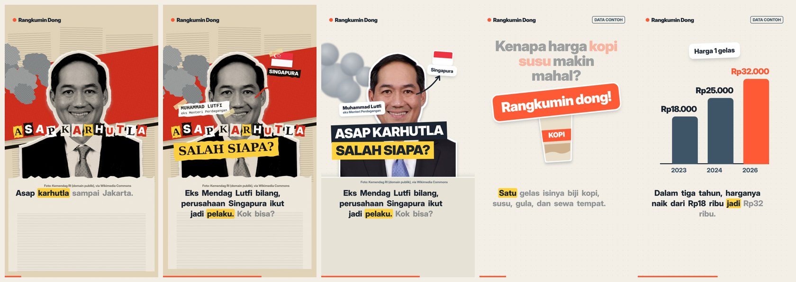
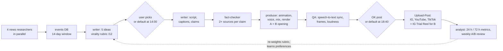

# ai-video-studio

**An autonomous, multi-agent pipeline that researches, writes, animates, voices, checks and publishes
short explainer videos — every frame is code.** It runs the Indonesian news-explainer account
**Rangkumin Dong** (Instagram Reels, YouTube Shorts, TikTok) with two human touches a day: pick a topic,
say "OK post" (and both have safe defaults).



## What it does



- **Agents** (`.claude/agents/`): news researchers per beat, writer, fact-checker, producer, QA reviewer,
  analyst, plus chapter-builder and editor for a weekly long-form video. A coordinator session runs the day
  from a scheduled task and is the only one that talks to the owner; hand-offs are files, agents reply in ≤4 lines
  (keeps the coordinator's context small).
- **Learning loops:** topic preferences from the owner's picks (`prefs.py`), rubric weights re-tuned weekly from
  real watch-time and shares, and a daily same-topic A/B test of the opening (B goes out as an Instagram Trial Reel).
- **Guardrails:** an independent fact-check on every claim, sensitivity rules for politics and legal cases,
  automatic posting only when QA passes and nothing is marked high-sensitivity, licensed photos only with on-screen credit.

## How a video is made

1. `script.json` — narration lines (`text` = subtitle, `say` = pronunciation, optional `hook_b` opening).
2. `python3 -I engine/tts_eleven.py <video> <account> male|female` — ElevenLabs voice with character timestamps →
   word-level timings (`build/timing.js`); long pauses compressed, no dead air before the first word.
3. `index.html` — the animation: a page that draws any time `t` (`window.seek(t)`), using the sticker kit
   (`styles/sticker/`: springs, camera, word-synced subtitles, charts, maps).
4. `python3 -I engine/mix.py <video>` — voice + code-synthesised music bed + SFX, mastered to −14 LUFS.
5. `node engine/render.mjs <video>` — headless Chromium screenshots every frame, ffmpeg encodes 1080×1920 @ 30 fps.
6. QA: `engine/qa_sync.py` (speech-to-text vs subtitle timings: median offset, % of words within tolerance),
   `engine/safezone.py` (platform UI overlays), contact sheets for a reviewer agent.
7. `engine/variant.py` — the B opening: re-voices only the hook lines and splices them onto A's take.
8. `engine/post.py` — publishes via Upload-Post (`--trial` for an Instagram Trial Reel).

Other tools: `commons.py` + `cutout.py` (licensed Wikimedia photos → background-removed cut-outs with credits),
`map.mjs` (d3-geo maps), `retime.py` (speed up a take without new TTS), `health.py` (credit / connection checks),
`higgsfield.py` (optional AI b-roll, labelled), `day.py` / `events.py` / `covered.py` (daily run state,
events database, no-repeat topic log).

## Try the examples

```bash
npm install                      # playwright-core + @sparticuz/chromium (no system Chrome needed)
node engine/render.mjs examples/style-test            # 20 s demo with sample data
node engine/render.mjs examples/hook-collage --stills 1   # collage cut-out opening, one still per second
```
The examples ship with their timings and mix, so no API keys are needed to render them.
Re-voicing needs an ElevenLabs key in `~/.config/explainer-studio/.env` (`ELEVENLABS_API_KEY=…`); keys are never stored in the repo.

## Layout

```
engine/            render, voice, mix, QA, posting, run state
styles/sticker/    the shared style kit (CSS tokens + JS helpers)
.claude/agents/    agent role files; .claude/shared/ shared researcher rules
examples/          renderable demos (style test, person hook, collage hook)
case-study/        Rangkumin Dong's brand settings and playbook (method, not data)
```

Built with Claude (Anthropic). Example styles: the collage hook follows mg-styles-15 by Vincent Wei (MIT).
